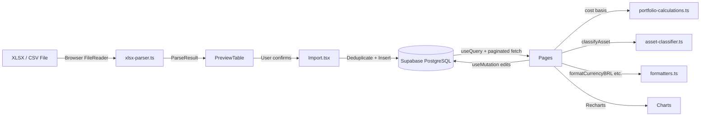

# Portfolio Tracker — Architecture & Business Logic

> **Repository:** `joao-sallaberry/portfolio-tracker`
> **Last updated from source on:** 2026-10-17

---

## 1. High-Level Summary

Portfolio Tracker is a **single-page web application** for managing a personal investment portfolio on the Brazilian stock market (**B3**). It allows a user to:

1. **Import** brokerage account statements (XLSX/CSV) containing trade operations and dividend events.
2. **Browse, edit and sort** imported trades and dividends with filtering and pagination.
3. **View** an aggregated cost-basis position (quantity × average price) per asset.
4. **Analyse** income tax obligations by computing capital gains, losses, exemptions and accumulated tax per month/year.
5. **Visualise** portfolio distribution and dividend history through interactive charts.

The entire UI is in **Brazilian Portuguese**.

---

## 2. Tech Stack

| Layer | Technology | Notes |
|---|---|---|
| **Build** | [Vite 8](vite.config.ts) + SWC plugin | Dev server on port `8080`, `@` → `./src` alias |
| **Tests** | Vitest 4 | Unit tests for the cost-basis logic (`npm run test`) |
| **UI Framework** | React 18 (TypeScript, non-strict) | No SSR — pure SPA |
| **Routing** | `react-router-dom` v6 | Client-side routing |
| **Styling** | TailwindCSS 3 + `tailwindcss-animate` | Theme defined in [index.css](src/index.css) with light/dark mode CSS variables |
| **Component Library** | shadcn/ui (Radix primitives) | 49 UI components in `src/components/ui/` |
| **Charts** | Recharts 2 | Bar charts, pie charts |
| **Server / Data** | [Supabase](src/integrations/supabase/client.ts) (PostgreSQL + Auth) | Hosted project `vhihtrrnbxsxaqbrivam` |
| **State / Caching** | TanStack React Query v5 | `useQuery` for reads, `useMutation` for edits |
| **File Parsing** | [SheetJS (xlsx)](src/lib/xlsx-parser.ts) | Client-side XLSX/CSV parsing |
| **Form Validation** | Zod + React Hook Form | Installed but **not used** in current pages |
| **Date Utilities** | `date-fns` with `ptBR` locale | Date filters use native `<input type="date">` |
| **Icons** | `lucide-react` | SVG icon library |
| **Fonts** | DM Sans (body) + JetBrains Mono (monospace) | Loaded from Google Fonts in [index.css](src/index.css) |
| **Dev Tooling** | `lovable-tagger` | Component tagger active in dev mode only |

---

## 3. Project Structure

```
portfolio-tracker/
├── index.html                  # HTML shell (SPA entry)
├── vite.config.ts              # Build config, `@` → `./src` alias
├── tailwind.config.ts          # Tailwind theme extensions
├── .env.example                # Template for .env (Supabase URL + publishable key)
├── supabase/
│   ├── config.toml             # Supabase CLI project id
│   ├── schema_unified.sql      # Full current DDL + RLS for a fresh database (see §4.4)
│   └── migrations/             # 9 incremental migration files
└── src/
    ├── main.tsx                # React root mount
    ├── App.tsx                 # Auth guard + router + providers
    ├── index.css               # Design system tokens (CSS vars)
    ├── integrations/supabase/
    │   ├── client.ts           # Supabase client singleton
    │   └── types.ts            # Generated DB types
    ├── lib/
    │   ├── portfolio-calculations.ts       # Cost basis / average price (shared)
    │   ├── portfolio-calculations.test.ts  # Vitest unit tests
    │   ├── formatters.ts       # BRL currency, dates, number parsing
    │   ├── asset-classifier.ts # Ticker → asset class lookup
    │   ├── xlsx-parser.ts      # XLSX/CSV → typed row arrays with per-row errors
    │   └── utils.ts            # `cn()` helper (clsx + tailwind-merge)
    ├── data/                   # Known tickers per asset class (CSV)
    ├── hooks/                  # use-mobile, use-toast
    ├── components/
    │   ├── layout/             # AppLayout (sidebar + header), AppSidebar
    │   ├── import/             # FileUploadCard, PreviewTable
    │   └── ui/                 # shadcn/ui components (not modified)
    └── pages/
        ├── Auth.tsx            # Login / Sign-up
        ├── Index.tsx           # Dashboard (Visão Geral)
        ├── Import.tsx          # Data import workflow
        ├── Negociacoes.tsx     # Trade history browser + editing
        ├── Proventos.tsx       # Dividend history browser
        ├── Posicao.tsx         # Current position summary
        ├── ImpostoRenda.tsx    # Income tax calculator
        ├── Configuracoes.tsx   # Settings (profile + logout)
        └── NotFound.tsx        # 404 page
```

---

## 4. Database Schema

Two tables, both multi-tenant via `user_id`. The current schema is the result of applying all files in `supabase/migrations/` in order.

### 4.1 `trade_operations`

| Column | Type | Constraint |
|---|---|---|
| `id` | UUID (PK) | auto-generated |
| `user_id` | TEXT | **NOT NULL** — maps to `auth.uid()` |
| `trade_date` | DATE | |
| `movement_type` | TEXT | `CHECK (IN ('BUY', 'SELL', 'SPLIT', 'REVERSE_SPLIT', 'BONUS', 'AMORTIZATION'))` |
| `movement_type_raw` | TEXT | original label from the file |
| `market` | TEXT | e.g. `"Bovespa"` |
| `maturity` | TEXT (nullable) | |
| `institution` | TEXT | broker name |
| `ticker` | TEXT | e.g. `"PETR4"` |
| `quantity` | NUMERIC | |
| `price` | NUMERIC | per-unit price |
| `total_value` | NUMERIC | `quantity × price` |
| `exclude_from_ir` | BOOLEAN | default `false` — see §9.5 |
| `created_at` | TIMESTAMPTZ | auto `now()` |

### 4.2 `dividend_events`

| Column | Type | Constraint |
|---|---|---|
| `id` | UUID (PK) | auto-generated |
| `user_id` | TEXT | **NOT NULL** |
| `product_raw` | TEXT | original product name |
| `ticker` | TEXT | extracted by `extractTicker()` |
| `payment_date` | DATE | |
| `event_type` | TEXT | e.g. `"Dividendos"`, `"JCP"`, `"Rendimento"` |
| `institution` | TEXT | |
| `quantity` | NUMERIC | share quantity at payment |
| `unit_price` | NUMERIC | dividend per share |
| `net_value` | NUMERIC | total net amount received |
| `created_at` | TIMESTAMPTZ | auto `now()` |

### 4.3 Indexes and Row-Level Security

- Lookup indexes on `user_id`, `ticker` and the date column of each table.
- A composite **non-unique** index on the business columns of each table (`idx_*_dedupe_lookup`). These were originally unique, but migration `20260201215155_allow_duplicates.sql` dropped the uniqueness so that legitimate identical rows (e.g. two equal trades on the same day) can be stored. Deduplication is now **application-only** (§7.4).
- Both tables have RLS enabled with SELECT/INSERT/UPDATE/DELETE policies enforcing `auth.uid()::text = user_id`.

### 4.4 Schema files

`supabase/schema_unified.sql` builds the current schema from scratch in one run (paste it into the Supabase SQL Editor). It is the supported way to create a new database: replaying `supabase/migrations/` in order fails at `20260201205948_add_user_id_to_tables.sql`, which drops `idx_dividend_events_dedupe` without `IF EXISTS` after an earlier migration already removed it.

When changing the schema, add a migration (to apply to the existing database), update `schema_unified.sql` to match, and update `src/integrations/supabase/types.ts`.

---

## 5. Authentication

Implemented in [Auth.tsx](src/pages/Auth.tsx).

- **Email + password** via Supabase Auth (`signInWithPassword` / `signUp`). No OAuth or magic-link providers.
- Sign-up sets `emailRedirectTo` to `${window.location.origin}/auth`, so the confirmation link brings the user back to the app.
- Session is persisted in `localStorage` with auto-refresh tokens ([client.ts](src/integrations/supabase/client.ts)).
- Route protection is in [App.tsx](src/App.tsx): unauthenticated users are redirected to `/auth`; authenticated users on `/auth` are redirected to `/`.

---

## 6. Routing & Layout

| Path | Page Component | Description |
|---|---|---|
| `/auth` | `Auth` | Login / Sign-up (public) |
| `/` | `Index` | Dashboard overview |
| `/importar` | `Import` | Data import from files |
| `/negociacoes` | `Negociacoes` | Trade operations browser |
| `/proventos` | `Proventos` | Dividend events browser |
| `/posicao` | `Posicao` | Current position summary |
| `/imposto-renda` | `ImpostoRenda` | Income tax calculator |
| `/configuracoes` | `Configuracoes` | User settings |
| `*` | `NotFound` | 404 fallback |

All routes except `/auth` are wrapped in [AppLayout](src/components/layout/AppLayout.tsx) (collapsible sidebar + header). Navigation items are defined in [AppSidebar.tsx](src/components/layout/AppSidebar.tsx).

---

## 7. Data Import Pipeline

The import page ([Import.tsx](src/pages/Import.tsx)) is the **primary data ingestion path**. It handles two independent flows (proventos / negociações), each going through `idle → parsing → preview → importing → success | error`.

### 7.1 File Parsing

Implemented in [xlsx-parser.ts](src/lib/xlsx-parser.ts). Every parser normalizes tickers with `normalizeTicker()`, so fractional-market tickers (`PETR4F`) are stored as the base ticker (`PETR4`). The fractional origin stays in `trade_operations.market` (`Mercado Fracionário`) for B3 XLSX imports. Every parser returns `ParseResult<T>` with `data[]`, `errors[]` (file-level, e.g. missing headers), `warnings[]` and `totalRows`. Each parsed row carries `hasErrors` and `errorMessages[]`.

- **Proventos** (`parseProventosFile()`): B3 XLSX with columns `Produto`, `Pagamento`, `Tipo de Evento`, `Instituição`, `Quantidade`, `Preço unitário`, `Valor líquido`. A row is flagged when product, payment date or event type is missing/invalid.
- **Negociações** (`parseNegociacaoFileAuto()` picks the format):
  1. **XLSX** (B3 statement): `Data do Negócio`, `Tipo de Movimentação`, `Mercado`, `Prazo/Vencimento`, `Instituição`, `Código de Negociação`, `Quantidade`, `Preço`, `Valor` — parsed by `parseNegociacaoFile()`.
  2. **Simplified CSV**: `Ticker`, `Data`, `Preço un.`, `Qtd`, `Tipo`. Dates in `DD/MM/YYYY` or `DD/MM/YY`.

  A row is flagged when date, movement type or ticker is missing/invalid, or when the movement type is unknown.

#### Movement Type Normalisation

[normalizeMovementType()](src/lib/formatters.ts) maps the raw label:

| Raw input (Portuguese) | Normalised value |
|---|---|
| `Compra`, `buy` | `BUY` |
| `Venda`, `sell` | `SELL` |
| `Bonificação`, `bonus` | `BONUS` |
| `Desdobramento`, `split` | `SPLIT` |
| `Grupamento`, `reverse_split` | `REVERSE_SPLIT` |
| `Amortização`, `amortization` | `AMORTIZATION` |
| anything else | `UNKNOWN` (row flagged as error) |

### 7.2 Preview & Confirmation

[PreviewTable](src/components/import/PreviewTable.tsx) shows the first 20 rows (rows with errors highlighted, messages in the tooltip), the first 10 warnings and the valid-row count. File-level errors disable **"Confirmar importação"**. Rows with `hasErrors` are skipped on import.

### 7.3 Insertion

Valid rows are mapped to DB columns, tagged with `user_id`, deduplicated (§7.4) and inserted in a single `insert()` call.

### 7.4 Deduplication Logic

Before inserting, the page fetches **all existing records** for the user and builds a frequency map keyed on:

- proventos: `ticker-payment_date-event_type-quantity-net_value`
- negociações: `trade_date-movement_type-ticker-quantity-total_value`

Each incoming row "consumes" one existing match; only rows beyond the existing count are inserted. Re-importing the same file adds nothing, while a file with three identical rows against one in the DB inserts two. The database no longer enforces uniqueness (§4.3).

### 7.5 Data Clearing

Two "clear history" buttons delete all rows from `dividend_events` or `trade_operations` for the current user (via `.delete().neq('id', '00000000-...')` — Supabase requires a filter on delete).

---

## 8. Asset Classification

Implemented in [asset-classifier.ts](src/lib/asset-classifier.ts).

```typescript
type AssetClass = 'Ação' | 'ETF' | 'FII' | 'FI-Infra' | 'FIP' | 'Outro';
```

Five CSV files under `src/data/` are imported at build time (Vite `?raw`) and parsed into `Set<string>` lookups keyed on the **first 4 characters** of each ticker:

| CSV File | Asset Class | Delimiter | Ticker Column Index |
|---|---|---|---|
| `Acoes.csv` | Ação | `,` | 0 |
| `ETFs.csv` | ETF | `;` | 2 |
| `FIIs.csv` | FII | `;` | 2 |
| `FI-Infras.csv` | FI-Infra | `;` | 2 |
| `FIPs.csv` | FIP | `;` | 2 |

`classifyAsset(ticker)` checks ETF → FII → FI-Infra → FIP → Ação → fallback `"Outro"`. ETFs come first because some ETF base codes could collide with stock base codes.

---

## 9. Business Logic

### 9.0 Cost Basis (shared)

All average-price calculations go through [portfolio-calculations.ts](src/lib/portfolio-calculations.ts) (weighted average cost method):

| Function | Purpose |
|---|---|
| `applyTradeToCostBasis(basis, trade)` | Pure reducer: applies one trade to `{ quantity, totalCost }` |
| `calculateCostBasis(trades)` | Sorts one ticker's trades by date and folds them |
| `calculatePositions(trades)` | Per-ticker positions with asset class, filtered to `quantity > 0` |
| `sortTradesByDate(trades)` | Stable ascending sort (same-day trades keep input order) |
| `getAveragePrice(basis)` | `totalCost / quantity`, or 0 |

Rules per movement type:

| Movement | Quantity | Total cost |
|---|---|---|
| `BUY`, `BONUS` | `+ qty` | `+ total_value` |
| `SELL` | `− qty` | reduced at the current average price (average unchanged) |
| `AMORTIZATION` | unchanged | `− total_value` |
| `SPLIT` | `+ qty` | unchanged (average diluted) |
| `REVERSE_SPLIT` | `− qty` | unchanged (average concentrated) |

A `SELL` or `REVERSE_SPLIT` that takes the quantity to zero or below resets the position to empty, so an oversold quantity is not carried into later buys. Unknown types leave the basis untouched. These rules are covered by `portfolio-calculations.test.ts`.

### 9.1 Dashboard — [Index.tsx](src/pages/Index.tsx)

**Empty state:** a welcome screen with a CTA to `/importar`.

**KPIs (4 cards):**
- **Total Investido**: `Σ BUY.total_value − Σ SELL.total_value`
- **Total em Proventos**: `Σ dividend.net_value` (all time)
- **Proventos no Ano**: same, current year
- **Operações no Ano**: count of trades in the current year

**Charts:**
1. **Proventos por Mês** — monthly dividend totals (last 12 months).
2. **Distribuição do Portfólio** — pie chart of net invested value per `AssetClass`.
3. **Proventos por Ativo (Top 8)** — horizontal bar chart of top dividend-paying tickers.

The dashboard does **not** use the shared cost basis (see §14).

### 9.2 Negociações — [Negociacoes.tsx](src/pages/Negociacoes.tsx)

- Paginated table (50 items/page).
- Filters: start/end date (native date inputs), movement type, ticker, asset class.
- Summary cards: Total Compras (`BUY` + `BONUS`), Total Vendas (`SELL` + `AMORTIZATION`), operation count.
- **Edit dialog**: changes date, type (also updates `movement_type_raw`), ticker (normalized with `normalizeTicker()`), institution, quantity, price and total value through a `useMutation` that invalidates `['trade-operations']`.
- **"Excluir do IR" switch** on `SELL` rows toggles `exclude_from_ir`.

### 9.3 Proventos — [Proventos.tsx](src/pages/Proventos.tsx)

- Filters: date presets (all, current/last month, current/last year, past 12 months, past 5 years — editing a date switches to "custom"), start/end date, event type, asset class, ticker.
- Column sorting on every column (asset class sorts by `classifyAsset`).
- Table footer with the total of the filtered rows.
- Summary cards: total, current year, event count, distinct event types.
- **Stacked bar chart** of monthly dividends by asset class, with per-class toggles.

### 9.4 Posição — [Posicao.tsx](src/pages/Posicao.tsx)

Uses `calculatePositions()` (§9.0). Positions are grouped by asset class (Ações, FIIs, ETFs, FI-Infra, FIP, Outros), each in its own card with quantity, average price, total value and portfolio weight. Columns are sortable (default: total value descending).

> **Limitation:** this is a **cost-basis** position. There is no market price data.

### 9.5 Imposto de Renda — [ImpostoRenda.tsx](src/pages/ImpostoRenda.tsx)

Two tabs, both built on the shared cost basis (§9.0).

#### Tab 1: "Vendas por Classe" (Sales by Tax Group)

| Group | Tax Rate | Asset Classes |
|---|---|---|
| Ações e ETFs | 15% | Ação, ETF |
| FIIs | 20% | FII |
| Isentos | 0% | FI-Infra, FIP |

For the selected group and year:

1. For each ticker, walk its trades in date order. For each `SELL` in the year, record `profit_loss = (sale_price − avg_price_before_sale) × quantity`.
2. **Oversold sales** (quantity sold exceeds the held position) are flagged with `oversold_position` and never generate tax.
3. **Sales excluded from IR** (`exclude_from_ir`) are listed but have `profit_loss` and `tax_due` zeroed. Their economic P&L is kept for display only. They still update the average price.
4. Sales are grouped by month and sorted by date (then id). Within a month, tax is charged only on profit above the month-to-date cumulative P&L, so earlier losses in the month offset later gains.
5. **R$20k exemption** (Ações e ETFs group only): if a month's total `Ação` sales (ETFs excluded) are ≤ R$20,000 and its `Ação` profit is positive, the tax on those sales is removed and the month is flagged `has_exemption`.
6. **Accumulated loss** is carried across months, starting from a user-entered initial loss for the group/year. Exempt profit does not offset it, and the balance never goes positive.

Summary cards: Total Vendas, Lucro/Prejuízo, Imposto Devido, and Lucro Isento (exempt profit from months with `has_exemption`).

#### Tab 2: "Por Ativo" (Per Asset)

- Select a ticker and a year.
- **Year-end snapshots**: position (quantity, total cost, average price) at Dec 31 of the selected and previous year — useful for the annual declaration.
- **Full trade history** with running quantity and running average price after each trade.

### 9.6 Configurações — [Configuracoes.tsx](src/pages/Configuracoes.tsx)

Shows the authenticated user's email and a logout button (`supabase.auth.signOut()`, redirect to `/auth`).

---

## 10. Formatting Utilities

All in [formatters.ts](src/lib/formatters.ts):

| Function | Purpose |
|---|---|
| `formatCurrencyBRL(n)` | `R$ 1.234,56` via `Intl.NumberFormat` |
| `formatDateBR(d)` | `DD/MM/YYYY` |
| `formatNumber(n, decimals)` | Locale-formatted number |
| `formatCompactNumber(n)` | `1.2K`, `3.4M` |
| `parseISODateLocal(s)` | Parses `YYYY-MM-DD` without timezone offset |
| `parseDateBR(s)` | Parses `DD/MM/YYYY` |
| `parseDateBRShort(s)` | Parses `DD/MM/YY` |
| `parseNumberBR(s)` | Parses `1.234,56` → `1234.56` |
| `parseCurrencyBR(s)` | Strips `R$` prefix, then `parseNumberBR()` |
| `extractTicker(s)` | Extracts ticker from `"PETR4 - PETROBRAS S.A."` |
| `normalizeTicker(s)` | Trims, uppercases and strips the fractional-market `F` suffix (`PETR4F` → `PETR4`) |
| `normalizeMovementType(s)` | Maps Portuguese movement labels to the enum (§7.1) |

---

## 11. Design System

### 11.1 Theme

Defined through CSS custom properties in [index.css](src/index.css), using an **Emerald Financial** palette:

- **Primary:** HSL `160 84% 39%` (emerald) — positive values and brand accents.
- **Destructive:** HSL `0 84% 60%` (red) — sells and errors.
- **Success:** HSL `142 76% 36%` (green) — buys.
- **Warning:** HSL `38 92% 50%` (amber).
- **Sidebar:** dark navy (`215 28% 17%`) with emerald accents.

Dark-mode variables are defined, but there is no toggle and no `ThemeProvider` is mounted (`next-themes` is installed but unused).

### 11.2 Custom Utility Classes

| Class | Effect |
|---|---|
| `.gradient-primary` | Emerald gradient background |
| `.gradient-card` | Subtle card gradient |
| `.shadow-glow` | Emerald glow box-shadow |
| `.glass` | Backdrop-blur glassmorphism |

---

## 12. Data Flow Architecture



**Key pattern:** every page that needs data fetches the user's full dataset with a `while` loop over `.range(from, from + pageSize - 1)` (page size 1000) to get past the PostgREST row limit, then filters and aggregates in memory.

---

## 13. Notable Patterns & Decisions

1. **No backend logic:** average price, tax computation and deduplication all run **client-side**. There are no Edge Functions, stored procedures or views.
2. **Full data fetch:** no server-side filtering, aggregation or pagination beyond React Query's cache.
3. **Single cost-basis implementation:** Posição and both IR tabs share `applyTradeToCostBasis()`, which is unit-tested.
4. **Static asset classification:** determined at build time from bundled CSVs.
5. **Application-only deduplication:** frequency-map matching before insert; the DB allows duplicates on purpose.
6. **Environment:** `.env` is gitignored; `.env.example` lists the required `VITE_SUPABASE_*` variables. Every `VITE_` variable is embedded in the client bundle, so only the publishable key belongs there.
7. **Lovable origin:** scaffolded with [Lovable](https://lovable.dev) (`lovable-tagger`, generated Supabase client/types).

---

## 14. Gaps, Limitations & Assumptions

| Area | Observation |
|---|---|
| **Market prices** | No live or historical prices. Posição shows cost basis only. |
| **Dashboard totals** | "Total Investido" and the distribution pie use `Σ BUY − Σ SELL` at **sale value**, not the cost basis. In the pie, every non-`BUY` movement counts as negative. Values diverge from Posição after profitable or losing sales. |
| **Initial accumulated loss** | Entered on the IR page but kept only in React state. It is lost on reload. |
| **Tax computation** | No distinction between day-trade (20%) and swing-trade (15%). The R$20k exemption applies to `Ação` sales only. |
| **Migration replay** | The migrations cannot be replayed from an empty database (§4.4). Use `schema_unified.sql` for new databases. |
| **Proventos pagination** | Proventos renders all filtered rows without pagination (Negociações paginates at 50). |
| **Dark mode toggle** | Dark-mode CSS variables exist, but there is no toggle. |
| **SEO / Meta tags** | `index.html` has a generic description, and `og:image` still points to Lovable's default image. |
| **Form validation** | `zod` and `react-hook-form` are unused. Forms use raw `useState`. |
| **Error handling** | Supabase errors are shown via toasts. There is no global error boundary. |
| **Test coverage** | Only `portfolio-calculations.ts` is tested. Parsers, deduplication and IR month/exemption logic are not. |
| **CSV data freshness** | Asset classification CSVs are static snapshots. New listings require manual updates. |
