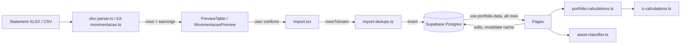

# Portfolio Tracker — Architecture & Business Logic

> **Repository:** `joao-sallaberry/portfolio-tracker`

---

## 1. High-Level Summary

Portfolio Tracker is a **single-page web application** for managing a personal investment portfolio on the Brazilian stock market (**B3**). It allows a user to:

1. **Import** brokerage account statements (XLSX/CSV) containing trade operations and dividend events.
2. **Browse, edit and sort** imported trades and dividends with filtering and pagination.
3. **View** an aggregated cost-basis position (quantity × average price) per asset.
4. **Analyse** income tax obligations by computing capital gains, losses, exemptions and accumulated tax per month/year.
5. **Visualise** portfolio distribution and dividend history through interactive charts.

The entire UI is in **Brazilian Portuguese**.

---

## 2. Tech Stack

Exact versions are in `package.json`; the table notes only what affects how the code is written.

| Layer | Technology | Notes |
|---|---|---|
| **Build** | [Vite](vite.config.ts) + `@vitejs/plugin-react` | Dev server on port `8080`, `@` → `./src` alias; the build fails without the `VITE_SUPABASE_*` env vars |
| **UI** | React 19, TypeScript (non-strict) | Pure SPA, no SSR; pages are lazy-loaded (§6) |
| **Routing** | `react-router` | Declarative `BrowserRouter` mode |
| **Styling** | Tailwind CSS **3** + `tailwindcss-animate` | Theme in [index.css](src/index.css) (§11). Tailwind 4 not adopted, so shadcn output written for it must be mapped back (see `chart.tsx`) |
| **Components** | shadcn/ui (Radix) | Only the components in use live in `src/components/ui/`; add others with the shadcn CLI |
| **Charts** | Recharts 3 | Through shadcn's `chart.tsx` |
| **Data** | [Supabase](src/integrations/supabase/client.ts) (Postgres + Auth) + TanStack Query | Hosted project `vhihtrrnbxsxaqbrivam`; no local stack |
| **File parsing** | [SheetJS](src/lib/xlsx-parser.ts) | Installed from `cdn.sheetjs.com` (the npm registry copy is outdated) |
| **Tests** | Vitest + Playwright | Unit tests next to the modules in `src/lib/`, E2E in `e2e/` against the hosted project (§14) |
| **Hosting** | Vercel | Deploys every push to `main`; `vercel.json` rewrites all paths to `index.html` |

---

## 3. Project Structure

```
portfolio-tracker/
├── index.html                  # HTML shell (SPA entry)
├── vite.config.ts              # Build config, `@` → `./src` alias
├── vercel.json                 # SPA rewrite: every path serves index.html
├── playwright.config.ts        # E2E: builds, serves on :4173, pt-BR / São Paulo timezone
├── e2e/                        # Playwright tests (auth, portfolio) against a dedicated test account
│   └── support/                # Test account login/reset, generated sample statements
├── tailwind.config.ts          # Tailwind theme extensions
├── .env.example                # Template for .env (Supabase URL + publishable key)
├── supabase/
│   ├── config.toml             # Supabase CLI project id
│   ├── schema_unified.sql      # Full current DDL + RLS for a fresh database (see §4.5)
│   └── migrations/             # 12 incremental migration files
└── src/
    ├── main.tsx                # React root mount (imports auth-recovery first)
    ├── App.tsx                 # Auth guard + router + providers
    ├── index.css               # Design system tokens (CSS vars)
    ├── integrations/supabase/
    │   ├── client.ts           # Supabase client singleton
    │   └── types.ts            # Generated DB types
    ├── lib/                    # Business logic; each *.ts below has a *.test.ts next to it except where noted
    │   ├── portfolio-calculations.ts  # Cost basis / average price (shared)
    │   ├── ir-calculations.ts  # IR sales, monthly tax, exemption, accumulated loss
    │   ├── xlsx-parser.ts      # Proventos and negociações statements → typed rows with per-row errors
    │   ├── b3-movimentacao.ts  # B3 movements statement → dividends + corporate events
    │   ├── import-dedupe.ts    # Skips rows already stored (frequency map)
    │   ├── formatters.ts       # BRL currency, dates, number parsing, ticker normalization
    │   ├── fetch-all-pages.ts  # Pages through PostgREST's 1000-row limit
    │   ├── asset-classifier.ts # Ticker → asset class lookup (no tests)
    │   ├── auth-recovery.ts    # Catches password-recovery links before the router loads (no tests)
    │   └── utils.ts            # `cn()` helper (clsx + tailwind-merge)
    ├── data/                   # Known tickers per asset class (CSV)
    ├── hooks/                  # use-portfolio-data (shared queries), use-pagination, use-mobile, use-toast
    ├── components/
    │   ├── layout/             # AppLayout (sidebar + header), AppSidebar
    │   ├── import/             # FileUploadCard, PreviewTable, MovimentacaoPreview
    │   ├── PaginationControls.tsx
    │   └── ui/                 # shadcn/ui components (not modified, except chart.tsx)
    └── pages/
        ├── Auth.tsx            # Login / Sign-up / forgot password
        ├── ResetPassword.tsx   # New password after the reset email
        ├── Index.tsx           # Dashboard (Visão Geral)
        ├── Import.tsx          # Data import workflow
        ├── Negociacoes.tsx     # Trade history browser + editing
        ├── Proventos.tsx       # Dividend history browser
        ├── Posicao.tsx         # Current position summary
        ├── ImpostoRenda.tsx    # Income tax calculator
        ├── Configuracoes.tsx   # Settings (profile + logout)
        └── NotFound.tsx        # 404 page
```

---

## 4. Database Schema

Three tables, all multi-tenant via `user_id`. The current schema is the result of applying all files in `supabase/migrations/` in order.

### 4.1 `trade_operations`

| Column | Type | Constraint |
|---|---|---|
| `id` | UUID (PK) | auto-generated |
| `user_id` | TEXT | **NOT NULL** — maps to `auth.uid()` |
| `trade_date` | DATE | |
| `movement_type` | TEXT | `CHECK (IN ('BUY', 'SELL', 'SPLIT', 'REVERSE_SPLIT', 'BONUS', 'AMORTIZATION'))` |
| `movement_type_raw` | TEXT | original label from the file |
| `market` | TEXT | from the B3 statement (e.g. `"Mercado à Vista"`, `"Mercado Fracionário"`), `"Bovespa"` for the simplified CSV, or `"Movimentação B3"` / `"Proventos B3"` for rows derived from those statements |
| `maturity` | TEXT (nullable) | |
| `institution` | TEXT | broker name |
| `ticker` | TEXT | e.g. `"PETR4"` |
| `quantity` | NUMERIC | |
| `price` | NUMERIC | per-unit price |
| `total_value` | NUMERIC | `quantity × price` |
| `exclude_from_ir` | BOOLEAN | default `false` — see §9.6 |
| `created_at` | TIMESTAMPTZ | auto `now()` |

### 4.2 `dividend_events`

| Column | Type | Constraint |
|---|---|---|
| `id` | UUID (PK) | auto-generated |
| `user_id` | TEXT | **NOT NULL** |
| `product_raw` | TEXT | original product name |
| `ticker` | TEXT | extracted by `extractTicker()` |
| `payment_date` | DATE | |
| `event_type` | TEXT | as in the statement: `"Dividendo"`, `"Juros Sobre Capital Próprio"`, `"Rendimento"`, `"Reembolso"` |
| `institution` | TEXT | |
| `quantity` | NUMERIC | share quantity at payment |
| `unit_price` | NUMERIC | dividend per share |
| `net_value` | NUMERIC | total net amount received |
| `created_at` | TIMESTAMPTZ | auto `now()` |

### 4.3 `ir_initial_losses`

| Column | Type | Constraint |
|---|---|---|
| `user_id` | TEXT | PK part, **NOT NULL** |
| `tax_group` | TEXT | PK part, `CHECK (IN ('Ações e ETFs', 'FIIs', 'Isentos'))` |
| `year` | INTEGER | PK part |
| `amount` | NUMERIC | `CHECK (amount <= 0)` |
| `updated_at` | TIMESTAMPTZ | auto `now()` |

Initial accumulated loss entered on the IR page (§9.6), one row per user, tax group and year. The page upserts on blur.

### 4.4 Indexes and Row-Level Security

- Lookup indexes on `user_id`, `ticker` and the date column of each table.
- A composite **non-unique** index on the business columns of each table (`idx_*_dedupe_lookup`). These were originally unique, but migration `20260201215155_allow_duplicates.sql` dropped the uniqueness so that legitimate identical rows (e.g. two equal trades on the same day) can be stored. Deduplication is now **application-only** (§7.4).
- All tables have RLS enabled with SELECT/INSERT/UPDATE/DELETE policies enforcing `auth.uid()::text = user_id`.

### 4.5 Schema files

There are two equivalent ways to build the schema from scratch:

- `supabase/schema_unified.sql` in one run (paste it into the Supabase SQL Editor). The production database was created this way.
- Replaying `supabase/migrations/` in order. The first migrations come from the Lovable era; `20261017200901_drop_legacy_lookup_indexes.sql` removes the indexes they created that production never had, so the result matches `schema_unified.sql` apart from column order.

Every local migration is registered in production's migration history (`supabase_migrations.schema_migrations`), so `supabase db push` only applies new ones. When changing the schema, add a migration, apply it, make sure the file's version matches the registered one, update `schema_unified.sql` to match, and regenerate `src/integrations/supabase/types.ts`.

---

## 5. Authentication

Implemented in [Auth.tsx](src/pages/Auth.tsx).

- **Email + password** via Supabase Auth (`signInWithPassword` / `signUp`). No OAuth or magic-link providers.
- Sign-up sets `emailRedirectTo` to `${window.location.origin}/auth`, so the confirmation link brings the user back to the app.
- **Forgot password:** "Esqueci minha senha" on the login tab calls `resetPasswordForEmail` with `redirectTo` = `/redefinir-senha`. The emailed link signs the user in with a recovery session; [ResetPassword.tsx](src/pages/ResetPassword.tsx) then sets the new password with `updateUser`. Without a session the page explains that the link is invalid or expired. If Supabase falls back to the Site URL (redirect not allow-listed), the `PASSWORD_RECOVERY` auth event still sends the user to `/redefinir-senha`. Both URLs (local and production) must be in Supabase's Auth → URL Configuration → Redirect URLs.
- Session is persisted in `localStorage` with auto-refresh tokens ([client.ts](src/integrations/supabase/client.ts)).
- Route protection is in [App.tsx](src/App.tsx): unauthenticated users are redirected to `/auth`; authenticated users on `/auth` are redirected to `/`.

---

## 6. Routing & Layout

| Path | Page Component | Description |
|---|---|---|
| `/auth` | `Auth` | Login / Sign-up / forgot password (public) |
| `/redefinir-senha` | `ResetPassword` | New password after the reset email (with or without session) |
| `/` | `Index` | Dashboard overview |
| `/importar` | `Import` | Data import from files |
| `/negociacoes` | `Negociacoes` | Trade operations browser |
| `/proventos` | `Proventos` | Dividend events browser |
| `/posicao` | `Posicao` | Current position summary |
| `/imposto-renda` | `ImpostoRenda` | Income tax calculator |
| `/configuracoes` | `Configuracoes` | User settings |
| `*` | `NotFound` | 404 fallback |

Pages are loaded on demand with `React.lazy` (a skeleton shows while a page's chunk downloads), so SheetJS ships only with Import and Recharts only with the chart pages. All routes except `/auth` are wrapped in [AppLayout](src/components/layout/AppLayout.tsx) (collapsible sidebar + header). Navigation items are defined in [AppSidebar.tsx](src/components/layout/AppSidebar.tsx).

---

## 7. Data Import Pipeline

The import page ([Import.tsx](src/pages/Import.tsx)) is the **primary data ingestion path**. It handles three independent flows (proventos / negociações / movimentações), each going through `idle → parsing → preview → importing → success | error`.

### 7.1 File Parsing

Proventos and negociações are parsed in [xlsx-parser.ts](src/lib/xlsx-parser.ts), movimentações in [b3-movimentacao.ts](src/lib/b3-movimentacao.ts). Every parser normalizes tickers with `normalizeTicker()`, so fractional-market tickers (`PETR4F`) are stored as the base ticker (`PETR4`). The fractional origin stays in `trade_operations.market` (`Mercado Fracionário`) for B3 XLSX imports. Every parser returns `data[]` (or, for the movements statement, `dividends[]` and `trades[]`), `errors[]` (file-level, e.g. missing headers), `warnings[]` and `totalRows`. Each parsed row carries `hasErrors` and `errorMessages[]`.

- **Proventos** (`parseProventosFile()`): B3 XLSX with columns `Produto`, `Pagamento`, `Tipo de Evento`, `Instituição`, `Quantidade`, `Preço unitário`, `Valor líquido`. A row is flagged when product, payment date or event type is missing/invalid. Capital returns (`Restituição de Capital`, `Amortização`) are not income: they come back in an extra `trades[]` as `AMORTIZATION` (`market = 'Proventos B3'`, with a warning) and are inserted into `trade_operations`, matching how the movements statement imports them, so the two dedupe against each other. The rows are parsed by `parseProventosRows()`, which the unit tests call directly.
- **Negociações** (`parseNegociacaoFileAuto()` picks the format):
  1. **XLSX** (B3 statement): `Data do Negócio`, `Tipo de Movimentação`, `Mercado`, `Prazo/Vencimento`, `Instituição`, `Código de Negociação`, `Quantidade`, `Preço`, `Valor` — parsed by `parseNegociacaoFile()`.
  2. **Simplified CSV**: `Ticker`, `Data`, `Preço un.`, `Qtd`, `Tipo`. Dates in `DD/MM/YYYY` or `DD/MM/YY`.

  A row is flagged when date, movement type or ticker is missing/invalid, or when the movement type is unknown.

#### Negociações: movement type normalisation

[normalizeMovementType()](src/lib/formatters.ts) maps the raw label:

| Raw input (Portuguese) | Normalised value |
|---|---|
| `Compra`, `buy` | `BUY` |
| `Venda`, `sell` | `SELL` |
| `Bonificação`, `bonus` | `BONUS` |
| `Desdobramento`, `split` | `SPLIT` |
| `Grupamento`, `reverse_split` | `REVERSE_SPLIT` |
| `Amortização`, `amortization` | `AMORTIZATION` |
| anything else | `UNKNOWN` (row flagged as error) |

#### Movimentações (B3 movements statement)

`parseMovimentacaoFile()` in [b3-movimentacao.ts](src/lib/b3-movimentacao.ts) reads the B3 "Extrato de Movimentação" (columns `Entrada/Saída`, `Data`, `Movimentação`, `Produto`, `Instituição`, `Quantidade`, `Preço unitário`, `Valor da Operação`) and classifies each row (credits only):

| Movimentação | Imported as |
|---|---|
| Dividendo, Juros Sobre Capital Próprio, Rendimento, Reembolso | dividend event (same `event_type` names as the dividends statement, so the two dedupe against each other) |
| Desdobro | `SPLIT` |
| Bonificação em Ativos | `BONUS`, whole shares only, zero cost (warning: edit the cost in Negociações) |
| Amortização, Restituição de Capital | `AMORTIZATION` (same as the dividends statement) |
| Resgate | `SELL` |
| Atualização | not imported, warning (sometimes adds shares, e.g. a fund merger, sometimes restates the position) |
| Transferência - Liquidação, Transferência, Empréstimo, Fração em Ativos, Leilão de Fração, subscription rights, `* - Transferido`, fixed income (CDB...) | ignored |
| anything else | not imported, warning |

Buys and sells are **not** taken from this statement: "Transferência - Liquidação" also records shares going to and returning from lending, at reference prices. They come from the trades statement. Trades from this statement get `market = 'Movimentação B3'`.

### 7.2 Preview & Confirmation

[PreviewTable](src/components/import/PreviewTable.tsx) shows the first 20 rows (rows with errors highlighted, messages in the tooltip), the first 10 warnings and the valid-row count. File-level errors disable **"Confirmar importação"**. Rows with `hasErrors` are skipped on import.

The movements statement has its own [MovimentacaoPreview](src/components/import/MovimentacaoPreview.tsx): counts per outcome, every warning (scrollable, since each one asks for a manual check), the ignored rows grouped by type, and separate tables for events and dividends. It reuses `PreviewRows` from PreviewTable.

### 7.3 Insertion

Valid rows are mapped to DB columns (dates as local `YYYY-MM-DD` via `formatISODateLocal`), tagged with `user_id`, deduplicated (§7.4) and inserted in a single `insert()` call (`insertNewDividends` / `insertNewTrades` in Import.tsx, shared by every import flow).

### 7.4 Deduplication Logic

Before inserting, the page fetches **all existing records** for the user (`fetchAllDividendEvents` / `fetchAllTradeOperations`, paginated) and builds a frequency map keyed on:

- proventos: `ticker-payment_date-event_type-quantity-net_value`
- negociações: `trade_date-movement_type-ticker-quantity-total_value`

Each incoming row "consumes" one existing match; only rows beyond the existing count are inserted. Re-importing the same file adds nothing, while a file with three identical rows against one in the DB inserts two. The database no longer enforces uniqueness (§4.4). The logic lives in [import-dedupe.ts](src/lib/import-dedupe.ts) (`rowsToInsert`, `dividendKey`, `tradeKey`), covered by unit tests. The keys ignore the institution and the unit price, so identical trades at two brokers on the same day count as one, and a trade edited in the app no longer matches its original statement row.

### 7.5 Data Clearing

Two "clear history" buttons delete all rows from `dividend_events` or `trade_operations` for the current user (via `.delete().neq('id', '00000000-...')` — Supabase requires a filter on delete).

---

## 8. Asset Classification

Implemented in [asset-classifier.ts](src/lib/asset-classifier.ts).

```typescript
type AssetClass = 'Ação' | 'ETF' | 'FII' | 'FI-Infra' | 'FIP' | 'Outro';
```

Five CSV files under `src/data/` are imported at build time (Vite `?raw`) and parsed into `Set<string>` lookups keyed on the **first 4 characters** of each ticker:

| CSV File | Asset Class | Delimiter | Ticker Column Index |
|---|---|---|---|
| `Acoes.csv` | Ação | `,` | 0 |
| `ETFs.csv` | ETF | `;` | 2 |
| `FIIs.csv` | FII | `;` | 2 |
| `FI-Infras.csv` | FI-Infra | `;` | 2 |
| `FIPs.csv` | FIP | `;` | 2 |

`classifyAsset(ticker)` checks ETF → FII → FI-Infra → FIP → Ação → fallback `"Outro"`. ETFs come first because some ETF base codes could collide with stock base codes.

---

## 9. Business Logic

### 9.1 Cost Basis (shared)

All average-price calculations go through [portfolio-calculations.ts](src/lib/portfolio-calculations.ts) (weighted average cost method):

| Function | Purpose |
|---|---|
| `applyTradeToCostBasis(basis, trade)` | Pure reducer: applies one trade to `{ quantity, totalCost }` |
| `calculateCostBasis(trades)` | Sorts one ticker's trades by date and folds them |
| `calculatePositions(trades)` | Per-ticker positions with asset class, filtered to `quantity > 0` |
| `sortTradesByDate(trades)` | Stable ascending sort (same-day trades keep input order) |
| `getAveragePrice(basis)` | `totalCost / quantity`, or 0 |

Rules per movement type:

| Movement | Quantity | Total cost |
|---|---|---|
| `BUY`, `BONUS` | `+ qty` | `+ total_value` |
| `SELL` | `− qty` | reduced at the current average price (average unchanged) |
| `AMORTIZATION` | unchanged | `− total_value` |
| `SPLIT` | `+ qty` | unchanged (average diluted) |
| `REVERSE_SPLIT` | `− qty` | unchanged (average concentrated) |

A `SELL` or `REVERSE_SPLIT` that takes the quantity to zero or below resets the position to empty, so an oversold quantity is not carried into later buys. Unknown types leave the basis untouched. These rules are covered by `portfolio-calculations.test.ts`.

### 9.2 Dashboard — [Index.tsx](src/pages/Index.tsx)

**Empty state:** a welcome screen with a CTA to `/importar`.

**KPIs (4 cards):**
- **Total Investido**: total cost of the current positions (`calculatePositions()`, same as Posição)
- **Total em Proventos**: `Σ dividend.net_value` (all time)
- **Proventos em {ano}**: same, current year
- **Operações em {ano}**: count of trades in the current year

**Charts:**
1. **Proventos por Mês** — monthly dividend totals (last 12 months).
2. **Distribuição do Portfólio** — pie chart of position cost per `AssetClass`.
3. **Proventos por Ativo (Top 8)** — horizontal bar chart of top dividend-paying tickers.

Dates are parsed with `parseISODateLocal()`, so payments on the 1st of a month are not shifted into the previous month by the UTC offset.

### 9.3 Negociações — [Negociacoes.tsx](src/pages/Negociacoes.tsx)

- Paginated table (50 items/page). Both browsers use the shared `usePagination` hook (back to page 1 when filters or sorting change) and `PaginationControls` component.
- Filters: start/end date (native date inputs), movement type, ticker, asset class.
- Summary cards: Total Compras (`BUY` + `BONUS`), Total Vendas (`SELL` + `AMORTIZATION`), operation count.
- **Edit dialog**: changes date, type (also updates `movement_type_raw`), ticker (normalized with `normalizeTicker()`), institution, quantity, price and total value through a `useMutation` that invalidates `['trade-operations']`.
- **"Excluir do IR" switch** on `SELL` rows toggles `exclude_from_ir`.

### 9.4 Proventos — [Proventos.tsx](src/pages/Proventos.tsx)

- Filters: date presets (all, current/last month, current/last year, past 12 months, past 5 years — editing a date switches to "custom"), start/end date, event type, asset class, ticker.
- Column sorting on every column (asset class sorts by `classifyAsset`).
- Paginated table (50 items/page, reset on filter or sort change) with a footer showing the total of **all** filtered rows.
- Summary cards: total, current year, event count, distinct event types.
- **Stacked bar chart** of monthly dividends by asset class, with per-class toggles.

### 9.5 Posição — [Posicao.tsx](src/pages/Posicao.tsx)

Uses `calculatePositions()` (§9.1). Positions are grouped by asset class (Ações, FIIs, ETFs, FI-Infra, FIP, Outros), each in its own card with quantity, average price, total value and portfolio weight. Columns are sortable (default: total value descending).

> **Limitation:** this is a **cost-basis** position. There is no market price data.

### 9.6 Imposto de Renda — [ImpostoRenda.tsx](src/pages/ImpostoRenda.tsx)

Two tabs, both built on the shared cost basis (§9.1). The Tab 1 logic lives in [ir-calculations.ts](src/lib/ir-calculations.ts) (`calculateSalesByTaxGroup`, `calculateGrandTotals`, `TAX_GROUPS`) and is covered by `ir-calculations.test.ts`. The page only fetches data and renders.

#### Tab 1: "Vendas por Classe" (Sales by Tax Group)

| Group | Tax Rate | Asset Classes |
|---|---|---|
| Ações e ETFs | 15% | Ação, ETF |
| FIIs | 20% | FII |
| Isentos | 0% | FI-Infra, FIP |

For the selected group and year:

1. For each ticker, walk its trades in date order. For each `SELL` in the year, record `profit_loss = (sale_price − avg_price_before_sale) × quantity`.
2. **Oversold sales** (quantity sold exceeds the held position) are flagged with `oversold_position` and never generate tax.
3. **Sales excluded from IR** (`exclude_from_ir`) are listed but have `profit_loss` and `tax_due` zeroed. Their economic P&L is kept for display only. They still update the average price.
4. Sales are grouped by month (listed by date, then id). Tax is charged on the month's **consolidated** result: `tax = rate × max(0, Σ P&L)` over the sales that count, regardless of their order. Losses of oversold sales reduce this base, but their gains are never taxed. Tax exists only per month (shown in the month header and the totals), not per sale.
5. **R$20k exemption** (Ações e ETFs group only): if a month's total `Ação` sales (ETFs excluded) are ≤ R$20,000 and its `Ação` profit is positive, the month is flagged `has_exemption` and its `Ação` sales are left out of the tax base, so only the ETFs' result is taxed.
6. **Accumulated loss** is carried across months, starting from a user-entered initial loss for the group/year (saved in `ir_initial_losses`, §4.3). Each month's result is added to it: a positive balance is taxed and clears the loss, a negative balance becomes the new accumulated loss. Exempt stock profit neither pays tax nor consumes the loss, and gains of oversold sales don't either.

Summary cards: Total Vendas, Lucro/Prejuízo, Imposto Devido, and Lucro Isento (exempt profit from months with `has_exemption`).

#### Tab 2: "Por Ativo" (Per Asset)

- Select a ticker and a year.
- **Year-end snapshots**: position (quantity, total cost, average price) at Dec 31 of the selected and previous year — useful for the annual declaration.
- **Full trade history** with running quantity and running average price after each trade.

### 9.7 Configurações — [Configuracoes.tsx](src/pages/Configuracoes.tsx)

Shows the authenticated user's email and a logout button (`supabase.auth.signOut()`, redirect to `/auth`).

---

## 10. Formatting Utilities

[formatters.ts](src/lib/formatters.ts) holds the BRL/date formatting (`formatCurrencyBRL`, `formatDateBR`, …) and the parsing of Brazilian-format input (`parseNumberBR`, `parseDateBR`, `extractTicker`, …). The ones with a rule to follow:

| Function | Rule |
|---|---|
| `parseISODateLocal(s)` | Use for every `YYYY-MM-DD` from the database. `new Date(s)` reads it as UTC midnight, which is the previous day in Brazil |
| `formatISODateLocal(d)` | Use when writing dates; `toISOString()` has the same UTC problem in reverse |
| `normalizeTicker(s)` | Apply wherever a ticker enters the database: uppercases and strips the fractional-market `F` (`PETR4F` → `PETR4`) |
| `normalizeMovementType(s)` | Broker labels → movement enum (§7.1) |

---

## 11. Design System

Colors are CSS custom properties in [index.css](src/index.css) (an emerald palette: primary emerald, `success` green for buys, `destructive` red for sells and errors, `warning` amber, dark navy sidebar), exposed to Tailwind in `tailwind.config.ts`. It also defines a few utilities (`.gradient-primary`, `.gradient-card`, `.shadow-glow`, `.glass`). Dark-mode variables exist, but there is no toggle and no `ThemeProvider` is mounted.

---

## 12. Data Flow Architecture



**Key pattern:** pages read data through [use-portfolio-data.ts](src/hooks/use-portfolio-data.ts): `useTradeOperations()` and `useDividendEvents()` fetch the user's full dataset (oldest first) under the shared query keys `TRADE_OPERATIONS_KEY` / `DIVIDEND_EVENTS_KEY`, so every page uses the same cache. They page through PostgREST's 1000-row limit with `fetchAllPages()`, ordering by date **and `id`** so rows don't repeat or go missing between pages. Pages filter and aggregate in memory; mutations and imports invalidate those keys.

---

## 13. Notable Patterns & Decisions

### 13.1 Technical

1. **No backend logic:** average price, tax computation and deduplication all run **client-side**. There are no Edge Functions, stored procedures or views.
2. **Full data fetch:** every page reads all of the user's rows and filters in memory; no server-side filtering, aggregation or pagination.
3. **Single cost-basis implementation:** Posição, the dashboard and both IR tabs share `applyTradeToCostBasis()`, which is unit-tested.
4. **Static asset classification:** determined at build time from bundled CSVs.
5. **Application-only deduplication:** frequency-map matching before insert; the DB allows duplicates on purpose.
6. **Environment:** `.env` is gitignored; `.env.example` lists the required `VITE_SUPABASE_*` variables. Every `VITE_` variable is embedded in the client bundle, so only the publishable key belongs there.
7. **Lovable origin:** scaffolded with [Lovable](https://lovable.dev), which generated the Supabase client/types and the shadcn/ui setup. The project is no longer edited through Lovable.

### 13.2 Business rules and why

1. **Buys and sells come only from the Negociação statement.** The movements statement records lending legs as "Transferência - Liquidação" with prices, indistinguishable from settlements; reading them as trades would inflate positions (§7.1).
2. **Capital returns reduce cost, they aren't income.** "Restituição de Capital" and "Amortização" give back part of the investment, so both the dividends and the movements statements import them as `AMORTIZATION` trades. That is also how they are treated for IR.
3. **Bonus shares enter at zero cost, whole shares only.** The statement doesn't carry the cost the company assigns per share, so the import warns and the user edits it. Fractions are sold in an auction; both the fraction and the auction are left out.
4. **"Atualização" is never imported.** It sometimes adds shares (a fund merger) and sometimes only restates a position, and the row doesn't say which. The import warns so the user can enter mergers by hand.
5. **Deduplication ignores the institution and the unit price.** B3 writes the same broker in more than one way over time (`BANCO BTG PACTUAL S/A` and `S/A.`), and the unit price is rounded differently per statement (2 decimals in Proventos, 3 in Movimentação); ticker, date, type, quantity and value identify a row.
6. **Tickers drop the fractional `F`.** `PETR4F` and `PETR4` are the same asset for position and tax.
7. **Oversold sales are never taxed.** A sale larger than the recorded position means trades are missing; its gain can't be computed, so only its loss counts.
8. **"Total Vendas" in Negociações includes `AMORTIZATION`.** It sums the cash that came back from the assets, not only sales. The IR calculations use sales only.

---

## 14. Gaps, Limitations & Assumptions

| Area | Observation |
|---|---|
| **Market prices** | No live or historical prices. Posição shows cost basis only. |
| **Tax computation** | No distinction between day-trade (20%) and swing-trade (15%). The R$20k exemption applies to `Ação` sales only. The loss carried into a year is not derived from previous years; the user enters it as the initial accumulated loss. |
| **Dark mode toggle** | Dark-mode CSS variables exist, but there is no toggle. |
| **Form validation** | Forms use raw `useState` without a validation library. |
| **Error handling** | Supabase errors are shown via toasts. There is no global error boundary. |
| **Test coverage** | Unit tests cover the cost basis, IR sales logic, statement parsers, import deduplication, formatters and pagination. E2E tests (`npm run test:e2e`) cover login and password reset, the three imports with deduplication, positions, dashboard totals, the IR page with the initial loss, and dividend pagination; they run against the hosted Supabase project (no local stack), using a dedicated test account. The IR "Por Ativo" tab and trade editing aren't covered. |
| **CSV data freshness** | Asset classification CSVs are static snapshots. New listings require manual updates. |
